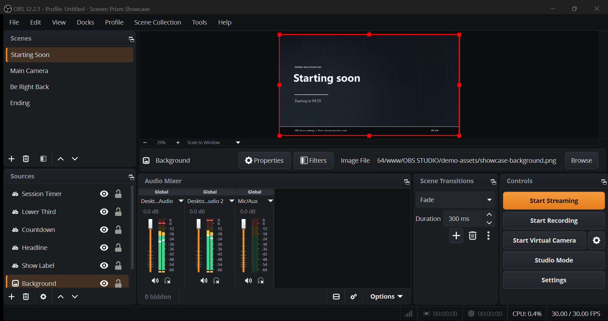
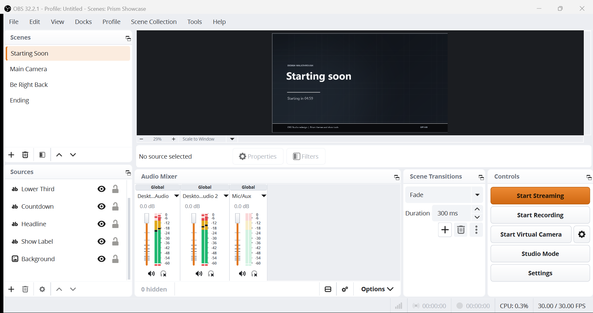
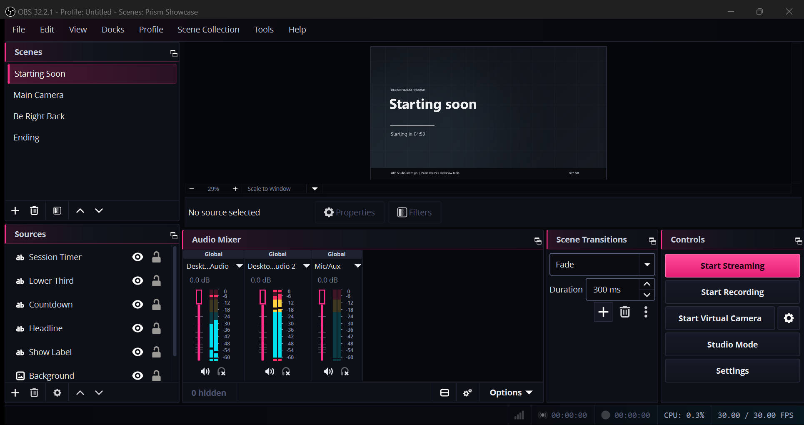
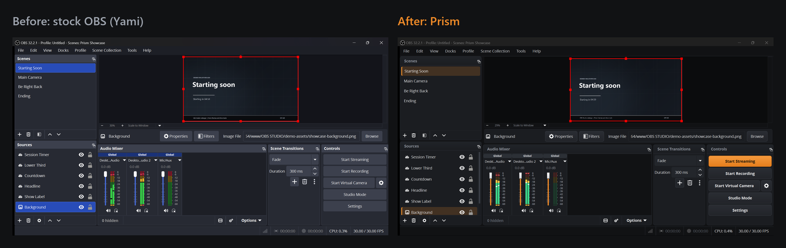

# OBS Redesign

**Modern themes and show tools for [OBS Studio](https://github.com/obsproject/obs-studio).**

Three themes built on OBS Studio's own theme system, plus three Lua scripts that add
features streamers keep asking for. Nothing is compiled and nothing is patched, so
everything installs in a minute and stays compatible with your existing OBS setup.




> This is an independent community project. It is not affiliated with or endorsed by
> the OBS Project. "OBS" and "OBS Studio" are trademarks of the OBS Project.

---

## Themes

| | Theme | Look |
|---|---|---|
|  | **Prism** | Graphite surfaces with a single signal-amber accent. Buttons have a subtle top-to-bottom shade, selections are a soft tint with an amber edge, and live/recording states use broadcast red. |
|  | **Prism Light** | The same design on porcelain and white panels. The video preview stays dark, as in professional editing tools, so on-screen colour is judged correctly. |
|  | **Cyber Pink** | A futuristic HUD look on blue-black surfaces. Hot pink marks actions, neon cyan marks focus, progress and audio levels. Panel headers have a pink edge with a soft fade, and status-bar timecodes are monospace. |

### Before and after



### Design principles

- **One accent, one job.** Colour signals what matters (the primary action, the current
  selection, focus) instead of decorating everything.
- **Broadcast conventions stay.** Red means live or recording. Audio meters run green,
  amber, red.
- **Familiar layout.** Every dock and button stays where OBS users expect it, so there is
  nothing to relearn.
- **Readable first.** Text and control colours were checked for contrast, including in the
  neon theme.

---

## Show tools (Lua scripts)

| Script | What it adds |
|---|---|
| [`prism-show-tools.lua`](scripts/prism-show-tools.lua) | **Session timer**: shows `LIVE 01:02:03` / `REC 00:12:45` in any Text source. **Stream health**: bitrate, dropped frames and FPS in a Text source. **Chapter markers**: a hotkey adds a chapter to the recording (native chapters in Hybrid MP4) and saves a YouTube-ready `… - chapters.txt` next to the file. **Smart replay names**: saved replays get the active scene name added to the start of the file name. |
| [`prism-scene-scheduler.lua`](scripts/prism-scene-scheduler.lua) | **Starting soon countdown** that updates a Text source, switches to your main scene at zero and can start the stream automatically. **Timed switches**: change scene at a set time of day. |
| [`prism-accent-studio.lua`](scripts/prism-accent-studio.lua) | **Accent Studio**: pick one accent colour or a preset (Signal Amber, Broadcast Blue, Emerald, Gold, Mono Silver) and generate a matching **Prism Custom** theme. Hover, pressed and tint shades are derived for you, and button text switches between dark and white for readability. |

---

## Installation

### Themes

**Windows (PowerShell):**

```powershell
git clone https://github.com/TWISTEDST1/OBA-REDESIGN.git
cd OBA-REDESIGN
.\install.ps1
```

**Manual install (any platform):** copy the files in [`themes/`](themes) into your OBS
user theme folder, creating it if needed:

| Platform | Folder |
|---|---|
| Windows | `%APPDATA%\obs-studio\themes` |
| macOS | `~/Library/Application Support/obs-studio/themes` |
| Linux | `~/.config/obs-studio/themes` |

Restart OBS Studio, then choose a theme in **Settings → Appearance**.

### Scripts

1. In OBS Studio, open **Tools → Scripts**.
2. Click **+** and select the `.lua` files from [`scripts/`](scripts).
3. Select a script to see its settings. Bind the hotkeys (*Prism: Add chapter marker*,
   *Prism: Start countdown*) in **Settings → Hotkeys**.

For the timer, countdown and health readouts, add a **Text (GDI+)** or **Text (FreeType 2)**
source to your scene first, then pick it in the script's settings.

---

## Compatibility

- Built for the theme system in current OBS Studio releases (developed against
  **OBS Studio 32.2.1** on Windows 11).
- The themes are variants of OBS's default *Yami* theme, so they follow OBS updates
  instead of replacing the base stylesheet.
- Native recording chapters require the Hybrid MP4/MOV format. With other formats the
  chapter list is still saved as a text file.

## Project structure

```
themes/        Prism, Prism Light and Cyber Pink theme variants (.ovt)
scripts/       Lua show tools for Tools → Scripts
screenshots/   Images used in this README
install.ps1    Windows theme installer
```

## Feedback

Found a widget that looks off, or have an idea for a theme or tool?
[Open an issue](https://github.com/TWISTEDST1/OBA-REDESIGN/issues). Screenshots help a lot.

## Credits

- [OBS Studio](https://github.com/obsproject/obs-studio) by the OBS Project, the
  open-source software these themes and scripts are built for.
- The *Yami* base theme by Warchamp7, which every theme here extends.

## License

Released under the GNU General Public License v2.0 or later, the same license as
OBS Studio. See [LICENSE](LICENSE).
